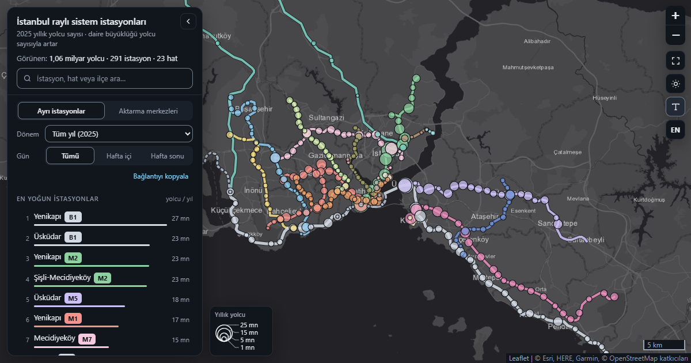

# Istanbul Rail Systems 2025: A Ridership Analysis

[Türkçe](README.md) · **English**

## Purpose

This project looks at how Istanbul's rail network was used in 2025, based on open ridership data. I compared the metro, tram, funicular, cable car and Marmaray lines to see which ones carry the most passengers, how usage changes through the year, and how the passenger profile differs from line to line.

I also identified the days with unusual ridership and looked into what caused them, and I put station-level ridership on an interactive map.

The questions I set out to answer:

- Which rail lines in Istanbul are used the most?
- Which lines carry the most passengers per trip?
- How does rail usage change over the year?
- On which days was ridership unusually high or low?
- How do the passenger age groups differ between lines?
- Do campus lines and sightseeing lines show term-time or seasonal patterns?
- How is ridership distributed across stations in the city?

## Links

- **[Interactive station ridership map](https://ismailsamib.github.io/istanbul-rayli-sistemler/harita/istasyon_kullanim_haritasi.html#dil=en)** (Turkish and English)
- **[Kod Hattı: an interactive Python tutorial built on this project's code](https://ismailsamib.github.io/istanbul-rayli-sistemler/ogretici/)** (Turkish only)
- **[IMM Open Data Portal](https://data.ibb.gov.tr)**

## Highlights

- About 1.06 billion entries were recorded on the rail network in 2025. The six busiest lines carry 73% of all passengers, and Marmaray alone accounts for roughly a fifth.
- Marmaray ranks first by total passengers. By passengers per trip, M5 comes out on top (809 passengers per trip).
- The largest drops of the year came on religious holidays, on the snow days of 20–21 February, after the 23 April earthquake, and on 1 May. On 1 May, entries at 45 stations fell to almost zero.
- TF1, F4 and M6 serve university campuses. All three drop clearly in the summer months, and they are the three lines with the highest share of passengers aged 20–30.

## Charts

The chart labels are in Turkish.

### Annual passengers by line


### Passengers per trip


M5 is fourth by total passengers but first by passengers per trip. T1 is third by total, but because it runs far more trips it is eighth here. Marmaray, M11, and the TCDD and İETT lines are missing from this chart because there is no trip data for them.

### Unusual days


I compared each day with the same weekday in the four weeks before and after it. Red dots are the anomalies the method detected; grey diamonds are known events that it missed.

### Campus lines and a sightseeing line


I noticed a striking rise on TF1 on 18 January. It was finals week, and TF1 goes to the İTÜ Taşkışla campus. That led me to look at how campus lines follow the academic calendar and how the sightseeing line TF2 follows the seasons.

The other charts (line shares, the ten busiest stations, the monthly trend, age distribution, weekend usage, and the relationship between the 60+ share and weekend usage) are in the `figures` folder.

## Station ridership map

**[Open the map](https://ismailsamib.github.io/istanbul-rayli-sistemler/harita/istasyon_kullanim_haritasi.html#dil=en)**



An interactive map of 2025 ridership at 291 points: 288 stations, plus the line totals of three lines that are not recorded per station. Circle size grows with the number of passengers, and colour shows the line. Clicking a line's name focuses the map on that line and fades the others; the checkbox next to it hides the line completely. Line routes are drawn from the real track geometry in OpenStreetMap.

The map shows more than the annual total. You can choose a period (the whole year or a single month) and a day type (all days, weekdays, weekends), and the circles are resized to the daily average for that selection. Clicking a station opens a panel with its trend over the twelve months, its weekend-to-weekday ratio and the age distribution of its passengers. Focusing a line shows its profile: the stations in route order with their ridership (the single-record lines T2, T3 and TF1 have no profile). The "Transfer hubs" view merges nearby stations of different lines into one circle.

The focused line, period, day type, view, hidden lines and language are written to the address bar, so any view can be shared as a link. Daily averages are the total divided by the number of calendar days, so stations that opened during the year show lower figures. The monthly chart in a station's panel is the exception: it is based on the average of the months that have data. The interface is available in Turkish and English; station, district and route names are left in Turkish.

Most station coordinates come from the original IMM data. Nine stations that sat clearly off their track were moved to the stop positions in OpenStreetMap (corrections of roughly 140 to 800 metres); the largest was about 800 metres, at M9 Ataköy. The coordinate of M5 Yamanevler was corrected separately. Misspelled station names and duplicate records were also fixed.

Details of how the map is built are in `harita/README.md` (in Turkish).

Basemap: Esri World Gray Canvas (light and dark).  
Sources: ridership data from the IMM Open Data Portal; track geometry and stop positions © OpenStreetMap contributors (ODbL).

## Data

I used two datasets from the Istanbul Metropolitan Municipality (IMM) Open Data Portal:

- [Station-level passenger and journey counts on rail systems by age group](https://data.ibb.gov.tr/dataset/yas-grubuna-gore-rayli-sistemler-istasyon-bazli-yolcu-ve-yolculuk-sayilari) (the 2025 file; daily passenger counts by station and age group, 678,010 rows, 23 lines)
- [Trip counts on rail systems by line](https://data.ibb.gov.tr/dataset/rayli-sistemler-hat-bazli-sefer-sayilari) (monthly trip counts by line, 2017–2025)

The data is published under the Istanbul Metropolitan Municipality Open Data Licence.

The data files are not in the repository because of their size. To run the project, download the two files from the portal and put them in the project folder without renaming them.

## Data cleaning

- The coordinate columns were corrupted (the decimal points had shifted). They are not used in the analysis, so I dropped them.
- T3 and the nostalgic tram had no station names. These lines are not recorded per station, so I used the line name in place of a station name.
- Two stations on M7 had no district. Kazım Karabekir was listed under Esenler; it is in Gaziosmanpaşa, so I corrected it.
- I fixed the `"Unkown"` typo in the age group column and made the age groups an ordered category.
- I extracted short codes from the line names (M1, T1 and so on). The record `"TCDD TASIMACILIK A.S."` turned out to be Marmaray, so I renamed it.
- Empty cells in the trip data do not always mean zero. For some lines the line had not opened yet; for others no data was kept. T3, TF1 and TF2, for example, all start in January 2018. So I removed the empty cells rather than filling them with zero.

## Method notes

**Anomaly detection:** The data has a strong weekly cycle, so I compared each day with the same weekday in the four weeks before and after it. I measured the deviation with the median and MAD (a robust z-score) instead of the mean and standard deviation, because extreme values pull the mean and can hide some anomalies.

A day is flagged when two conditions hold: `|robust z| > 3.5` and a deviation larger than `5%`.

The method caught 12 of the 18 events I already knew about. Some of the misses are public holidays with free transport: fewer people commute on those days but more travel for leisure, so the total may not change much.

Other misses fall in transition periods such as the start of the school year. When the reference days themselves are scattered, the method treats a deviation of the same size as less unusual.

**60+ share and weekend usage:** At line level the Spearman correlation is ρ = 0.62 (p = 0.002, bootstrap 95% confidence interval 0.30–0.82, n = 23).

This is a relationship between lines; it should not be read as "older people travel more at weekends". I think the common factor is the character of the line: short, central lines used for sightseeing may attract both more passengers over 60 and more weekend passengers.

**Passenger counts:** The data has two counts, `passage_cnt` and `passanger_cnt`. `passage_cnt` is never lower than `passanger_cnt`, and the gap is larger on sightseeing lines and in the 60+ group.

The "passenger" figure probably counts distinct cards. Several people can pass on one card, and the same person can enter the same station more than once in a day. I used `passanger_cnt` in the analysis.

## Limitations

- The analysis uses 2025 data only.
- Because of shared cards and entries without a card (small children, for example), real usage on some lines may be higher than the data shows.
- There is no vehicle capacity data, so passengers per trip does not show how full the trains are.
- The data is daily, so I could not look at hourly peaks.
- The explanations for the anomalies come from the calendar and from news searches. I marked 19 April (an Open Education Faculty exam) as "probable". I could not find a cause for the anomalies on 11 November and on 7 and 28 December.
- The line the data calls "TCDD Halkalı-Başakşehir" appears with only 3 stations (Halkalı, Ispartakule, Bahçeşehir); the map shows it as "Halkalı – Bahçeşehir".

## Project structure

```text
clean_data.py      cleans the passenger data, writes passenger_clean.csv
clean_trips.py     cleans the trip data, writes trips_clean.csv
analiz.ipynb       all analyses and charts
figures/           charts
harita/            the station ridership map and the scripts that build it
ogretici/          interactive Python tutorial (GitHub Pages, Turkish)
requirements.txt   required Python packages
```

## How to run

```text
python -m venv venv
venv\Scripts\activate
pip install -r requirements.txt
python clean_data.py
python clean_trips.py
```

Then open `analiz.ipynb` and run the cells.
The steps for rebuilding the map are in `harita/README.md`.
